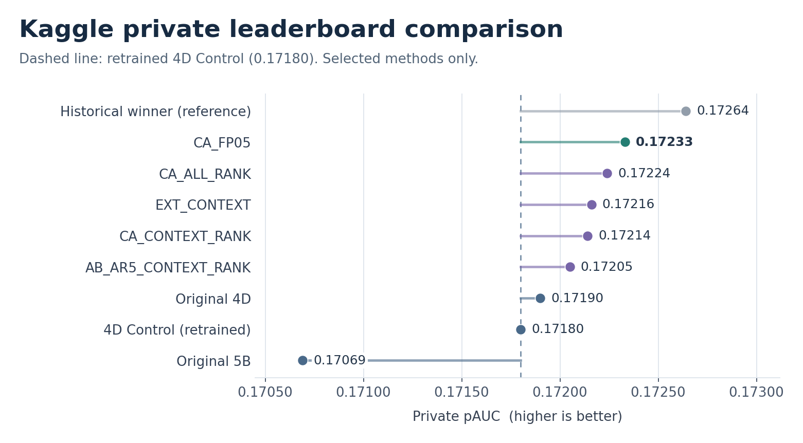
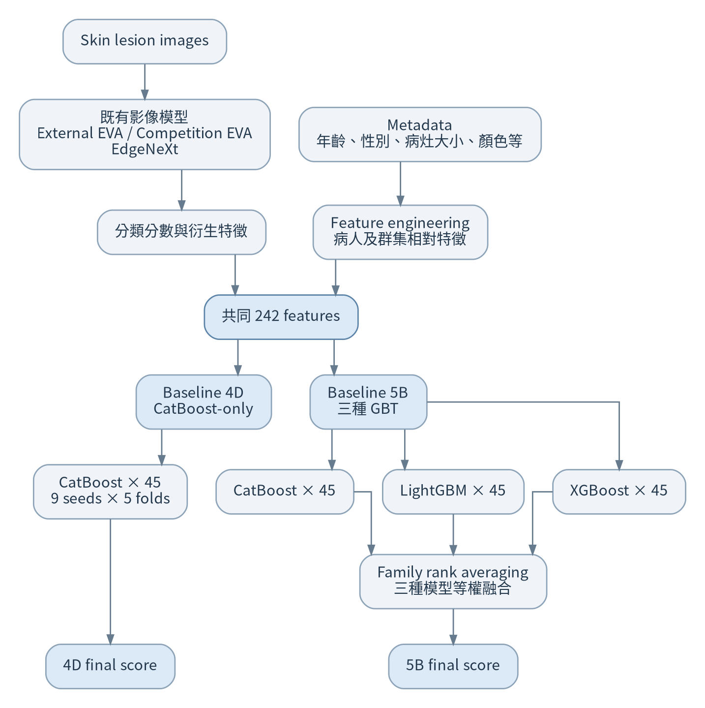
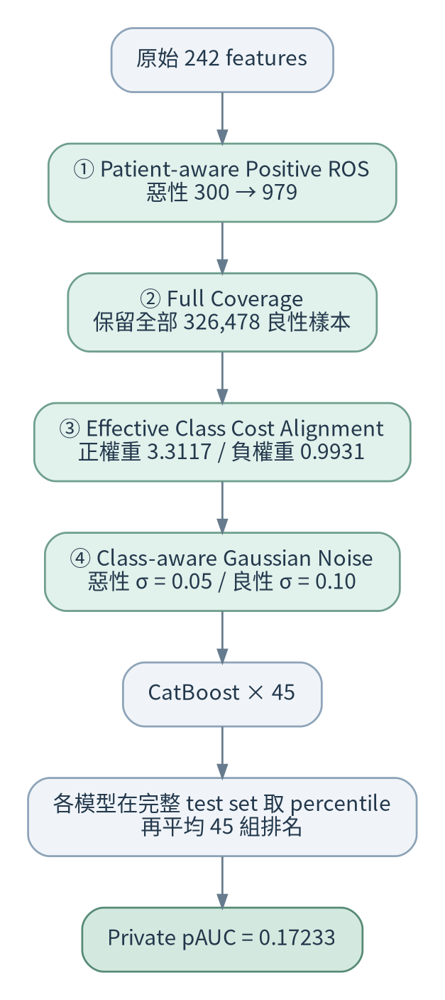
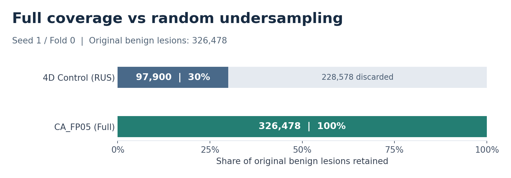
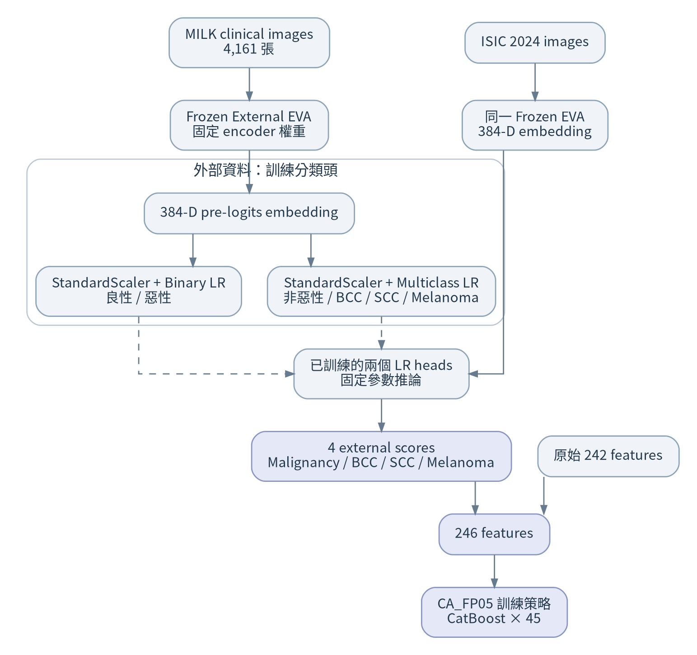
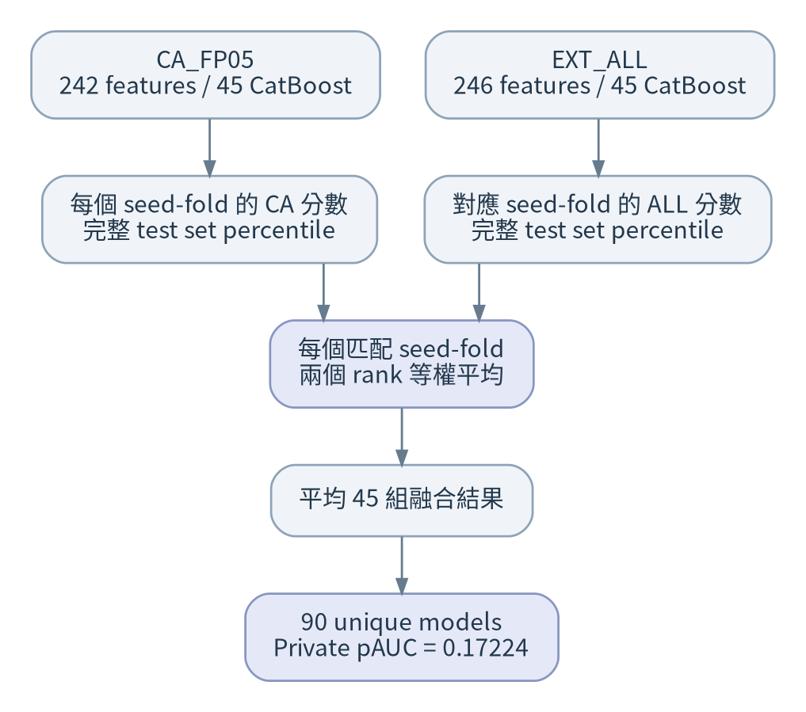
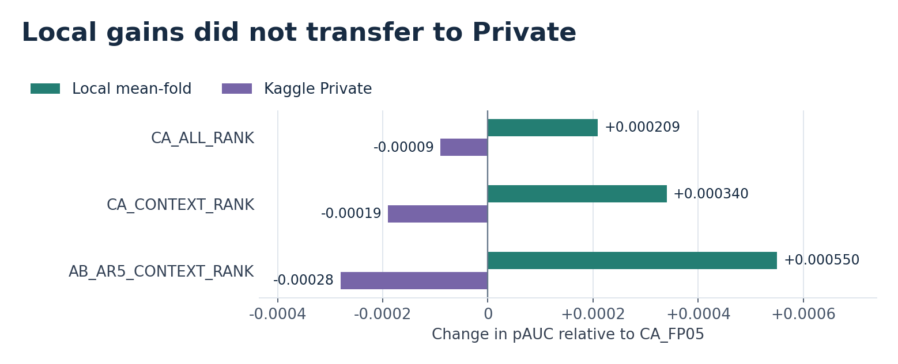

# ISIC 2024｜專題研究進度與主要成果

更新日期：2026-11-27

研究目標：改善極端類別不平衡下的皮膚癌病灶分類，並探討新增外部資料（External Dataset）能否進一步提升表現。

## 1. 目前成果（Summary）

**目前最佳方法：CA_FP05，Kaggle Private pAUC = 0.17233。** 相較原始 4D 提升 **0.00043**，相較重新訓練的 4D Control 提升 **0.00053**，距離歷史冠軍分數 0.17264 尚差 0.00031。

新增外部資料的最佳 Private 結果為 **CA_ALL_RANK：0.17224**，雖優於 Control，但仍低於 CA_FP05。因此，目前已改善基準模型，尚未證明新增外部資料能進一步改善最強模型。

| 方法 | 新增外部資料 | 下游 GBT 數量 | Local pAUC | Public | Private |
| :--- | :---: | ---: | ---: | ---: | ---: |
| 原始 4D | 否 | 45 | — | 0.18547 | 0.17190 |
| 原始 5B（CB + LGB + XGB） | 否 | 135 | — | 0.18585 | 0.17069 |
| 4D Control（重訓基準） | 否 | 45 | 0.181579 | — | 0.17180 |
| **CA_FP05（目前最佳）** | 否 | 45 | 0.182252 | 0.18559 | **0.17233** |
| EXT_ALL | MILK10k | 45 | 0.182281 | — | — |
| EXT_CONTEXT | MILK10k | 45 | 0.182502 | 0.18520 | 0.17216 |
| **CA_ALL_RANK（外部最佳 Private）** | MILK10k | 90 | 0.182461 | 0.18550 | **0.17224** |
| CA_CONTEXT_RANK | MILK10k | 90 | 0.182592 | 0.18548 | 0.17214 |
| AB_AR5_CONTEXT_RANK（本輪最佳 Local） | MILK10k | 135 | **0.182802** | 0.18546 | 0.17205 |
| 歷史冠軍分數（參考） | — | — | — | — | 0.17264 |

> Local 統一為 Seeds 1–9 × 5 patient-level folds 的 Mean fold pAUC，非 pooled OOF。— 表示本摘要未列出已核實的對應數值。「否」指未加入本研究新增外部資料，原 Baseline 已使用既有 External EVA。原始 4D 與重新訓練的 Control 為不同版本；Local 比較以後者為共同對照。5B 的 135 個模型包含三種 GBT，不是 135 個 CatBoost。

**圖 1｜代表方法的 Kaggle Private pAUC**

本輪 15 組提交皆未超越 CA_FP05。圖中歷史冠軍為分數參考，而非目前專案的模型。

以下聚焦三個核心方法：**Baseline（4D / 5B / Control）→ CA_FP05 → External Dataset**。

---

## 2. Baseline 4D、5B 與 Control：原本如何訓練？

### 2.1 資料與模型架構

ISIC 2024 訓練集共 401,059 個病灶、1,042 位病人，其中良性 400,666、惡性僅 393（0.098%，約 1:1,020）。任務是判斷個別病灶是否惡性，而非病人是否罹癌。

原 Baseline 直接使用既有影像模型 checkpoints，**下游接收 CNN 分類分數，而非高維 embedding**。我們重新訓練的是 GBT，不是原 CNN。

- External EVA：`old_set_0`（Nevus / other）、`old_set_1`（BKL 分組，包含部分 BCC）、`old_set_2`（Melanoma）。
- Competition EVA、EdgeNeXt：各提供一個良性／惡性分類分數。
- Metadata 與特徵工程：包含病灶特性、病人內相對統計等，共整合為 242 features。

### 2.2 三個基準版本有何不同？

| 項目 | 原始 Baseline 4D | 原始 Baseline 5B | 4D Control（重訓基準） |
| :--- | :--- | :--- | :--- |
| 用途 | 原始架構重現 | 三種 GBT 的原始集成 | 後續改良的共同實驗對照 |
| 既有 CNN / 特徵 | 相同既有 checkpoints / 242 | 相同既有 checkpoints / 242 | 沿用 4D / 242 |
| 下游模型 | CatBoost × 45 | CB、LGB、XGB 各 × 45 | 重新訓練 CatBoost × 45 |
| 訓練策略 | 原始 4D 流程 | 三種 learner 的基準流程 | 保留 4D 的 ROS、RUS、noise 與超參數 |
| Local CV | 本摘要未確認 | 本摘要未確認 | 固定 Seeds 1–9、同一組 patient folds 與對照隨機流程 |
| Public | 0.18547 | 0.18585 | — |
| Private | 0.17190 | 0.17069 | 0.17180 |

**為什麼另外建立 4D Control？** 不是再增加一個模型架構，而是以原始 4D 為基礎重新訓練，建立能與後續方法逐 seed / fold 配對的共同對照。這樣可比較相同病人切分、相同特徵與模型設定下，改變抽樣、權重或 noise 的影響。原始 4D 與 Control 是不同提交產物，不能將兩者的 Local / Private 混用。原始與重訓版本的完整部署差異仍需核對各自 manifest，不能將 0.00010 差異直接歸因於某個參數。

**5B 如何融合？** 每個 native model 先在完整 test set 轉成 percentile rank；各 learner 的 45 組 rank 分別平均，再將 CB、LGB、XGB 三個 family 等權平均（各 1/3）。不是直接平均 135 個原始分數。5B 的 Private 低於 4D，因此後續主要以 4D 為改良主軸，但保留 5B 作為另一個 baseline。

### 2.3 4D / Control 的類別不平衡處理

以實際 Seed 1 / Fold 0 為例，原訓練集 326,778 筆，validation 74,281 筆（不抽樣）。

| 步驟 | 惡性 | 良性 | 說明 |
| :--- | ---: | ---: | :--- |
| 原始 Training fold | 300 | 326,478 | 約 1:1,088 |
| ROS = 0.003 | 979 | 326,478 | 隨機重複抽取 679 筆惡性病灶 |
| RUS = 0.01 | 979 | 97,900 | 隨機減少良性病灶，達到 1:100 |
| Gaussian noise | 979 | 97,900 | 對兩個標準化後的 competition CNN 直接分數加入 σ = 0.10 的擾動 |

ROS/RUS 的參數指抽樣後的正／負樣本數量比。Noise 只加在訓練資料的 `oof_eva_score` 與 `oof_edgenext_score`，不是修改影像，也不修改 validation。

**改良動機：** RUS 捨棄約 70% 的良性樣本，可能造成資訊流失；普通 ROS 又會較頻繁地抽取擁有較多惡性病灶的病人。

---

## 3. CA_FP05：目前最佳方法

CA_FP05 不改變原有 242 features 或 CNN checkpoints，而是同時改良抽樣、樣本權重及分數增強。

### 3.1 四項主要改良

**① Patient-aware Positive Oversampling：平衡新增惡性樣本的病人貢獻**

原本每個惡性病灶等機率抽取；新方法使用病人的惡性病灶數倒數作為抽樣權重。假設病人 A 有 8 個惡性病灶，B、C 各有 1 個：

| 病人 | 惡性病灶數 | 普通 ROS：病人被抽中機率 | Patient-aware ROS |
| :--- | ---: | ---: | ---: |
| A | 8 | 80% | 33.3% |
| B | 1 | 10% | 33.3% |
| C | 1 | 10% | 33.3% |

實際 Fold 0 有 207 位帶有惡性病灶的病人，每筆惡性病灶的新增抽取機率為 `1 / (207 × 該病人的惡性病灶數)`。原本 300 筆全部保留，僅改變新增 679 筆的抽取方式；不是強制每位病人最終樣本數相同。

**② Full Coverage：保留全部良性樣本**

*圖 2｜相同 Fold 0 中，Control 僅保留約 30% 良性病灶，而 CA_FP05 保留全部。*

不再挑選或隨機捨棄良性病灶，讓模型學習完整的良性特徵分布。

**③ Effective Class Cost Alignment：對齊正負類別的有效訓練權重**

保留全部良性後，樣本數量比例由 1:100 變為約 1:333，因此使用 sample weights 將兩類權重總和之比恢復至 1:100。

- 未正規化：良性權重 = 1；惡性權重 = 0.01 × 326,478 / 979 ≈ 3.3348。
- 再將所有權重乘上共同係數，使平均 sample weight = 1。
- 最終惡性權重 = 3.3117、良性權重 = 0.9931。沒有額外再乘 `scale_pos_weight`。

$$
\frac{979\times3.3117}{326478\times0.9931}\approx0.01
$$

此處對齊的是有效權重總和，不表示兩種資料集的實際 loss 或訓練結果完全相同。

**④ Class-aware Gaussian Noise：惡性樣本使用較小擾動**

| 類別 | Baseline σ | CA_FP05 σ |
| :--- | ---: | ---: |
| 良性 | 0.10 | 0.10 |
| 惡性 | 0.10 | **0.05** |

在抽樣完成後對兩個標準化 CNN 分數加入零均值 Gaussian noise，不做 clipping；同一病灶的不同重複列可有不同擾動。設計假說是避免過度破壞稀少的惡性訊號；尚未證明此因素單獨帶來全部改善。

### 3.2 4D Control 與最佳方法比較

| 項目 | 4D Control | CA_FP05 |
| :--- | :--- | :--- |
| 正樣本新增抽樣 | Random ROS | Patient-aware ROS |
| 負樣本抽樣 | RUS | Full Coverage |
| Fold 0 最終正 / 負數量 | 979 / 97,900 | 979 / 326,478 |
| 最終訓練列數 | 98,879 | 327,457 |
| 正 / 負 sample weight | 1 / 1 | 3.3117 / 0.9931 |
| 有效正負權重比例 | 1:100 | 1:100 |
| 正 / 負 noise σ | 0.10 / 0.10 | 0.05 / 0.10 |
| Features / CatBoost 數量 | 242 / 45 | 242 / 45 |
| Local Mean pAUC | 0.181579 | **0.182252** |
| Kaggle Private | 0.17180 | **0.17233** |

兩者沿用相同 patient splits、CatBoost 超參數（Logloss、depth 6、最多 2,000 iterations 等）及 Local 評估程式。CA_FP05 部署時逐模型取全 test set percentile，再等權平均。Control 的部署融合仍須依原 manifest 核對；不應把整個 Private 增益單獨歸因於抽樣或 noise。

其他早期方法如 HNS 30%（Local 0.181441）及 PA-HNS Cap500（0.180457）未超過 Control。這促使研究從「如何選良性樣本」轉向「保留完整資料並調整學習方式」。

---

## 4. External Dataset：如何引入額外疾病資訊？

### 4.1 外部資料與研究動機

既有 External EVA 的 `old_set_2` 僅代表 Melanoma，而非所有皮膚癌。因此我們希望透過新增外部資料，取得 general malignancy 以及 BCC、SCC、Melanoma 的分類資訊。

| 資料集 | 使用影像 | 清理前 → 後 | 結果概況 |
| :--- | :--- | :--- | :--- |
| PAD-UFES-20 | 手機臨床影像 | 2,298 → 2,224 | 未優於 Control |
| MILK10k | Clinical close-up（不使用 dermoscopy） | 5,240 → 4,161 | 部分 Local 配置有增益 |

MILK 保留 938 非惡性、2,387 BCC、648 SCC（含 in situ）、188 Melanoma。清理考量診斷映射、重複及可能重疊影像；無 patient ID，僅能依 lesion / duplicate component 分組，不能保證病人層級完全獨立。

### 4.2 EXT_ALL：242 → 246 features

核心作法：**外部影像用於訓練 LR 分類頭，而不是直接增加 ISIC CatBoost 的訓練列數。** Encoder 保持 frozen；只訓練外部 StandardScaler 與 binary / multiclass LR，設定選擇在外部 grouped CV 內進行，不使用 ISIC labels 訓練外部分類頭。

General malignancy 分數來自獨立 binary LR，並非將三個 subtype 分數相加。實際部署沿用 v2 前處理：336×336 RGB、ImageNet normalization、FP32 embedding；保留原訓練設定。

### 4.3 EXT_CONTEXT：246 → 249 features

在 EXT_ALL 之上，利用同一病人完整病灶集合，對新增 malignancy score 計算三項相對特徵。假設同一病人三個病灶分數為 `[0.1, 0.1, 0.9]`，則最高分病灶的新特徵為：

| 特徵 | 計算方式 | 最高分病灶 |
| :--- | :--- | ---: |
| Patient percentile | (average rank − 0.5) / n | 0.8333 |
| Patient z-score | (score − mean) / population SD | 1.4142 |
| Difference from median | score − median | 0.8 |

此設計讓模型判斷病灶是否相對同病人的其他病灶異常，不使用 target label。單病灶或全 ties 的中性值為 `[0.5, 0, 0]`。

### 4.4 CA_ALL_RANK：目前最佳外部資料提交

Rank fusion 是先將各模型分數轉為排名，再平均，降低不同模型輸出尺度的影響。本專案 ensemble percentile = average-tie rank / N，與前述 patient percentile 不同。先完成每組匹配 seed/fold 的融合，再平均 45 組結果；不在 inference minibatch 中計算排名。

### 4.5 外部資料的實驗結論

| 方法 | Features | Local pAUC（9 seeds） | 相對對照 |
| :--- | ---: | ---: | :--- |
| 4D Control | 242 | 0.181579 | — |
| Control + MILK B-All | 246 | 0.181767 | +0.000188 vs Control |
| CA_FP05 | 242 | 0.182252 | — |
| EXT_ALL | 246 | 0.182281 | +0.000029 vs CA |
| EXT_CONTEXT | 249 | 0.182502 | +0.000250 vs CA |
| CA_ALL_RANK | 242 / 246 | 0.182461 | +0.000209 vs CA |
| CA_CONTEXT_RANK | 242 / 249 | 0.182592 | +0.000340 vs CA |

另外測過 PAD + MILK、不同 normalization、Frozen DINOv2、EVA partial fine-tuning 與 subtype-context。它們未顯示足以取代目前 frozen 方案的穩定增益；partial FT 的三-seed 結果低於對應 frozen 方法，未補做全面 fine-tuning。

外部資訊在部分 Local 評估中有互補性，但目前 45／90／135-model 的 external 提交均未改善最強 CA_FP05 的 Private，且多模型融合的改善仍需等模型預算對照。

---

## 5. 目前瓶頸與下一步

### Local 改善並未穩定轉移至 Private

| 外部融合相較 CA_FP05 | Local Mean fold Δ | Kaggle Private Δ |
| :--- | ---: | ---: |
| CA_ALL_RANK | +0.000209 | −0.00009 |
| CA_CONTEXT_RANK | +0.000340 | −0.00019 |
| AB_AR5_CONTEXT_RANK | +0.000550 | −0.00028 |

*圖 3｜相較 CA_FP05 的 pAUC 差值；Local 與 Private 是不同評估端點。*

最新 generalization audit 已確認：

- 原 CA 與 batch pipeline 在 83 張、3 個完整病人群組的端到端重播一致，未發現已測範圍的推論錯誤；不能據此保證 hidden-test 完全一致。
- CNN 與 CatBoost folds 未完整巢狀隔離，部分上游 CNN 的可抽樣訓練人口包含下游 validation 病人。實際抽樣名單與偏差大小仍未知。
- 58 組歷史方法 Local／Private Pearson 約 0.519，本輪 11 組 external 為 −0.544；僅為描述性結果，候選高度重疊。
- CA + ALL 的 Local 增益從 mean-fold 的 +0.000209，縮小至跨 seed 下游 held-out ensemble 的約 +0.000047。重複 CV 或 bootstrap 不等於獨立驗證。

